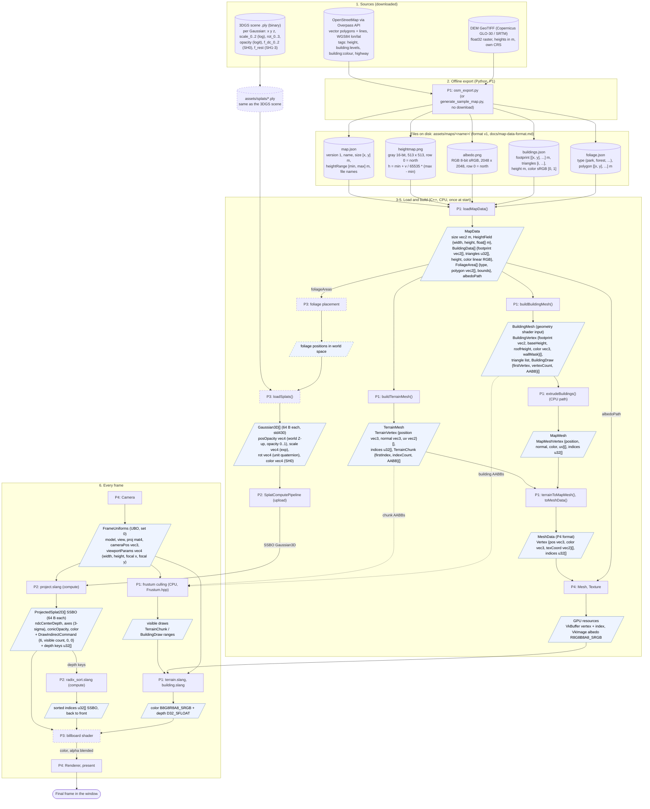

# Data flow (proposal)

> Sketch by P1: what data enters the project, who turns it into what, and what is handed to the next
> person, up to the final frame. Names marked *(planned)* do not exist yet and are proposals.
> P2 types are from `src/splat/SplatTypes.h` on `P2/Gaussian-Splatting-Compute-Core`.
> The per-frame GPU order is in [render-flow.md](render-flow.md); the map files are specified in
> [map-data-format.md](map-data-format.md).

## Overview

Read it like a UML activity diagram:

- **Rectangle**: a function or shader, with its owner (`P1: loadMapData()`).
- **Parallelogram**: data passed between two steps, with its format (type, fields, units).
- **Cylinder**: a file on disk or downloaded data, with its file format.
- **Dashed**: planned, not written yet.

## Intermediate data formats

| Data | Kind | Format | Made by | Read by |
|---|---|---|---|---|
| OSM features | Download | Vector polygons / lines, WGS84, OSM tags | Overpass API | P1 `osm_export.py` |
| DEM | Download | GeoTIFF, float32 heights in m | Copernicus / SRTM | P1 `osm_export.py` |
| `map.json` | File | JSON: `version` 1, `name`, `size` [x, y] m, `heightRange` [min, max] m, file names | P1 export | P1 `loadMapData()` |
| `heightmap.png` | File | 16-bit grayscale PNG, 513 x 513, row 0 = north, `h = min + v / 65535 * (max - min)` | P1 export | P1 `loadMapData()` |
| `albedo.png` | File | 8-bit RGB PNG, sRGB, 2048 x 2048, row 0 = north | P1 export | P4 `Texture` |
| `buildings.json` | File | JSON: `footprint` [[x, y], ...] m, `triangles` [i, ...], `height` m, `color` sRGB | P1 export | P1 `loadMapData()` |
| `foliage.json` | File | JSON: `type`, `polygon` [[x, y], ...] m | P1 export | P1 `loadMapData()`, then P3 |
| `.ply` | File | Binary PLY, standard 3DGS attributes (log scale, logit opacity, SH) | 3DGS training | P3 `loadSplats()` *(planned)* |
| `MapData` | C++ struct | `size`, `HeightField` (float m, row-major), `BuildingData[]`, `FoliageArea[]`, `albedoPath` | P1 `loadMapData()` | P1, P3, P4 |
| `TerrainMesh` | C++ struct | `TerrainVertex{position, normal, uv}`, u32 indices, chunks with AABB | P1 `buildTerrainMesh()` | P1 |
| `BuildingMesh` | C++ struct | `BuildingVertex{footprint, baseHeight, roofHeight, color, wallMask}` triangle list, one `BuildingDraw` per building | P1 `buildBuildingMesh()` | P1 (geometry shader, CPU extrusion) |
| `MapMesh` | C++ struct | `MapMeshVertex{position, normal, color, uv}`, u32 indices | P1 `extrudeBuildings()` | P1 `toMeshData()`, `writeMapObj()` |
| `MeshData` | C++ struct (P4) | `Vertex{pos, color, texCoord}`, u32 indices | P1 `toMeshData()` | P4 `Mesh` |
| `Gaussian3D[]` | C++ / SSBO | 4 x vec4, 64 B: `posOpacity`, `scale`, `rot`, `color` | P3 `loadSplats()` *(planned)* | P2 |
| `FrameUniforms` | UBO, set 0 | `model`, `view`, `proj`, `cameraPos`, `viewportParams` | P4 `Camera` | P1, P2, P3 |
| `ProjectedSplat2D[]` | SSBO | 4 x vec4, 64 B: `ndcCenterDepth`, `axes`, `conicOpacity`, `color` | P2 `project.slang` | P3 |
| `DrawIndirectCommand` | Buffer | `VkDrawIndirectCommand`: 6 vertices, visible splats as instances | P2 `project.slang` | P3 (indirect draw) |
| Sorted indices | SSBO | u32[], back to front | P2 `radix_sort.slang` | P3 |
| Color + depth | Images | `B8G8R8A8_SRGB` swapchain, `D32_SFLOAT` depth | P1 opaque pass | P3 (depth test), P4 present |

## Stage 1: sources

| Data | From | Format | Used for |
|---|---|---|---|
| Buildings, green areas, water, roads | OpenStreetMap via the Overpass API (`osmnx`) | Vector polygons / lines, WGS84 lon/lat, OSM tags (`height`, `building:levels`, `building:colour`) | Building footprints + heights, foliage areas, albedo |
| Terrain elevation | Copernicus GLO-30 or SRTM, e.g. from OpenTopography | GeoTIFF raster, meters | Heightmap (optional; flat without it) |
| Landmarks, foliage splats | 3DGS scenes, trained by us or public datasets *(to decide, P3)* | `.ply` with position, scale, rotation, opacity, SH colors | Splats |

## Stage 2: offline export (P1, Python)

| Step | Function (`tools/`) | Input | Output |
|---|---|---|---|
| Download | `osm_export.features()`, `ox.graph_from_bbox()`, `with_retries()` | `--bbox W S E N` | GeoDataFrames (WGS84) |
| Local frame | `ox.projection.project_gdf()`, `to_local()` | WGS84 | UTM meters, centered on the bbox: x east, y north |
| Buildings | `parse_height()`, `parse_color()`, `mapformat.make_building()` (`clean_polygon`, `triangulate`) | OSM polygons + tags | Footprint (CCW), triangles, height, color |
| Foliage | `mapformat.make_foliage_area()` | Parks, forests, grass | Polygon + kind |
| Albedo | PIL `ImageDraw` | Green, water, roads, buildings | `albedo.png`, row 0 = north |
| Heightmap | `rasterio.warp.reproject()`, `mapformat.write_heightmap_png()` | DEM GeoTIFF | `heightmap.png`, 16-bit, with `heightRange` |
| Write | `mapformat.write_map()` | All of the above | `map.json`, `buildings.json`, `foliage.json` |

`generate_sample_map.py` writes the same files from a synthetic city, without downloads.

**Hand-over:** the folder `assets/maps/<name>/` (format version 1). Readers: P1 (terrain, buildings),
P3 (`foliage.json` to place foliage splats), P4 (`map.size` for the camera range).

## Stage 3: load and build on the CPU (P1, C++)

| Function (`src/map/`) | Input | Output | Notes |
|---|---|---|---|
| `loadMapData()` | Map folder | `MapData` (size, `HeightField`, buildings, foliage, albedo path) | Rejects other format versions |
| `mapWorldToUv()`, `sampleTerrainHeight()` | `MapData`, world xy | uv, height | Shared helpers |
| `buildTerrainMesh()` | `MapData` | `TerrainMesh`: vertices (pos, normal, uv), indices, chunks with bounds | Grid up to 513², 32-cell chunks for culling |
| `buildBuildingMesh()` | `MapData` | `BuildingMesh`: footprint triangles + heights + wall mask, one draw per building | Input of the geometry shader |
| `extrudeBuildings()` | `BuildingMesh` | `MapMesh`: roofs + walls as triangles | CPU path, same rules as the geometry shader |
| `toMeshData()` | `MapMesh` | P4's `MeshData` (`Vertex{pos, color, texCoord}`, uint32 indices) | Hand-over to P4's `Mesh` |
| `writeMapObj()` | `MapMesh` | `.obj` + `.mtl` + albedo | Debug view in Blender / 3dviewer.net |

## Stage 4: splats on the CPU (P3, then P2) *(planned)*

| Function | Owner | Input | Output |
|---|---|---|---|
| `loadSplats()` *(planned)* | P3 | `.ply` | `std::vector<Gaussian3D>`: `posOpacity` (world, Z-up; opacity after sigmoid), `scale` (after exp), `rot` (unit quaternion), `color` (SH0) |
| Transform into the map *(planned)* | P3 | Splat positions + landmark placement (`landmarks.json`?) / foliage areas | Gaussians in world space |
| Upload | P2 | `Gaussian3D[]` | `SplatComputePipeline::inputGaussians` (SSBO, set 1 binding 0) |

## Stage 5: GPU resources (P4 framework)

| Class | Input | Output |
|---|---|---|
| `Mesh` | `MeshData` | Vertex + index buffer |
| Texture *(P4)* | `albedo.png` | Sampled image for the terrain shader |
| `Camera` | Window input | `FrameUniforms` / `UniformBufferObject`: model, view, proj, cameraPos, viewportParams (set 0) |

## Stage 6: every frame

| Step | Owner | Shader / function | Input | Output |
|---|---|---|---|---|
| Frustum culling | P1 | `Frustum.hpp` (CPU) | Chunk / building bounds, view-proj | Visible draws |
| Splat projection | P2 | `project.slang` (compute) | `Gaussian3D` SSBO, `FrameUniforms` | `ProjectedSplat2D` SSBO (NDC center + depth, axes, conic + opacity, color), `DrawIndirectCommand` |
| Sort | P2 | `radix_sort.slang` (compute) | View-space depth keys | Sorted indices (back to front) |
| Terrain | P1 | `mesh/terrain.slang` | Terrain buffers, albedo | Color + depth |
| Buildings | P1 | `mesh/building.slang` (vert, geom, frag) or CPU mesh | Building buffers | Color + depth |
| Splat billboards | P3 | billboard shader *(planned)* | `ProjectedSplat2D`, sorted indices, indirect args, depth buffer | Color, alpha-blended over the meshes |
| Present | P4 | `Renderer` | Swapchain image | **Final frame in the window** |

## Open points

1. Where the splat `.ply` files come from (own training or public scenes) and who converts them (P3?).
2. Landmark placement: a `landmarks.json` in the map folder (see map-data-format.md, open question 1)?
3. Splat orientation: trained scenes are usually Y-down or Y-up; they need a transform into Z-up world space.
